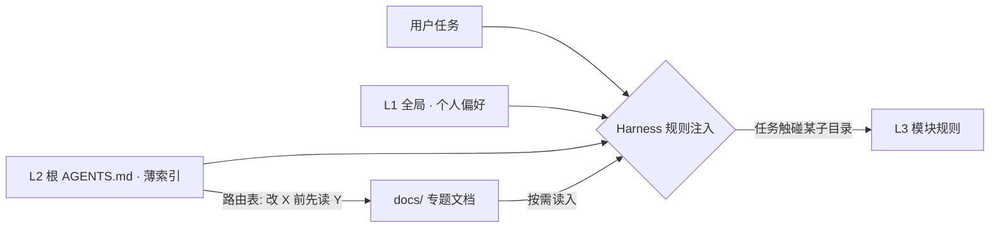

# AI Coding 规则工程指南 · 三级 Rules + 索引式 AGENTS.md

> 一套**与具体项目无关**的 Agent 规则体系：任何语言、任何框架、任何工具
> （Claude Code / Codex / Cursor / GitHub Copilot / Gemini CLI）都能直接套用。
> 方法论综合了 Anthropic Claude Code 官方最佳实践、OpenAI `AGENTS.md` 开放规范、
> Cursor Rules 分发机制，以及腾讯 Harness 工程文章的要点，落成可执行的 SOP。

---

## 0. TL;DR

四层结构，一张表说完：

| 层 | 典型位置 | 放什么 | 行数预算 | 加载方式 |
|---|---|---|---|---|
| **L1 全局** | `~/.claude/CLAUDE.md`、`~/.codex/AGENTS.md` | 个人偏好：语言/风格/通用工程习惯/安全红线 | ≤50 | 所有会话常驻 |
| **L2 项目** | 仓库根 `AGENTS.md` | 定位、已验证命令、目录地图、**路由表**、红线 | ≤150 | 本仓库常驻 |
| **L3 模块** | 子目录 `AGENTS.md` / 条件规则文件 | 该子树专属约定、坑、测试要求 | ≤50 | 触碰该目录才注入 |
| **外延** | `docs/**/*.md` | 大而全的专题文档（设计/协议/大纲） | 不限 | **从不常驻**，被路由表按需读取 |

三条铁律：

1. **越近优先**：子目录覆盖根目录，根目录覆盖全局；L1 永远不能覆盖 L2/L3。
2. **越薄越好**：每层只放该层独有的信息；同一条规则只允许出现在一层。
3. **按需加载**：常驻的只有索引；细节让 Agent 用到时自己读（just-in-time context）。

---

## 1. 为什么需要规则工程（Harness 思维）

**模型能力是租来的，Harness 是自己的资产。** 同一个模型，规则体系好坏直接决定：
首轮完成率、返工次数、上下文成本、跨工具行为一致性。

全量投喂（把所有规范塞进一个巨型规则文件）的四个代价：

| 问题 | 机制 |
|---|---|
| token 浪费 | 500 行规则 ≈ 6k+ token，**每一轮对话**都重复支付；20 轮会话白烧 12 万+ token（估算） |
| lost-in-the-middle | 长上下文中部的注意力衰减，埋在第 300 行的红线等于没写 |
| 规则冲突 | 同一要求在多处表述不同，改一处漏三处，Agent 行为变成随机数 |
| 快速腐化 | 文件越长越没人维护；一条过期命令会让 Agent 反复报错空转，比没有规则更糟 |

解法只有一个：**把「常驻」和「按需」分开**——常驻的永远是薄索引，细节全部下沉到
`docs/`，通过路由表在恰当时机注入。这就是"索引式 AGENTS.md"。

---

## 2. 总体架构



一次典型请求的注入顺序：

1. 工具自动加载 L1 + L2（常驻，无需任何机制）
2. 任务涉及某子目录 → 工具按 globs / 嵌套约定注入对应 L3
3. L2 路由表写着"改支付前先读 `docs/PAYMENT_PROTOCOL.md`" → Agent 主动读取
4. 全程常驻的只有 L1 + L2 +（命中的）L3；专题文档零常驻成本

### 这条规则该放哪？（决策树）

```text
这条规则所有项目都适用？
├─ 是 → L1 全局
└─ 否 → 本项目所有代码都适用？
        ├─ 是 → L2 根 AGENTS.md
        │        （若因此超 150 行 → 放 docs/ 并加进路由表）
        ├─ 否 → 只在某个子树适用？
        │        ├─ 是 → L3 模块规则
        │        └─ 否 → 只是偶尔参考的知识 → docs/ 专题 + 路由表
        └──────────── （永不常驻）
```

---

## 3. 三级 Rules 详解

### 3.1 L1 全局级 ——「我这个人」

- **内容**：语言偏好、回复风格、个人工程习惯、跨项目安全红线
- **判断标准**：换 10 个项目这条依然成立，才配进 L1
- **反例**：「本项目用 Riverpod」❌（这是 L2）；「提交前跑测试」✅
- **典型错误**：在 L1 写项目相关内容 → 污染所有其他仓库的会话

### 3.2 L2 项目级 ——「这个仓库」

- **内容五要素**：
  1. 一句话定位（这是什么、给谁用、技术栈）
  2. **已验证**的高频命令（安装/运行/测试/lint/构建）
  3. 目录地图（≤10 行，只到"改代码时需要知道"的粒度）
  4. **路由表**（索引式的灵魂："触碰 X 区域前必须先读 Y 文档"）
  5. 红线（≤5 条，条条可执行）
- **典型错误**：把教程、架构长文、changelog 写进 L2 → 应放 `docs/` 并路由

### 3.3 L3 模块级 ——「这块地盘」

- **内容**：该子树的专属约定、常见坑、模块级测试要求
- **分发机制**（按团队主力工具任选）：
  - 子目录 `AGENTS.md`（Codex / Claude Code / Gemini 嵌套读取）
  - Cursor：`.cursor/rules/<模块>.mdc`，frontmatter 写 `globs: ["src/services/**"]`
  - Copilot：`.github/instructions/<模块>.md`，frontmatter 写 `applyTo: "src/services/**"`
- **典型错误**：模块规则里重复根仓库的通用约定 → 未来打架

### 3.4 外延层 ——「图书馆」

`docs/` 不是 Rules 层级，但它是索引式的另一半：**路由表的目的地**。
设计规范、API 协议、领域知识、部署手册都住在这里。它们从不进上下文，
只有当任务触碰对应区域时才被读入。一个健康的仓库：`docs/` 可以无限厚，
根 `AGENTS.md` 永远薄。

### 3.5 冲突与覆盖原则

- **Nearest wins**：`lib/services/AGENTS.md` > 根 `AGENTS.md` > `~/.claude/CLAUDE.md`
- 覆盖是**抑制**不是合并：更近的层对同一话题有定义时，远层的表述作废
- 因此同一条规则绝不能出现在两层——不然你永远不知道哪层在生效

---

## 4. 索引式 AGENTS.md 解剖

### 4.1 五要素 + 填写规范

见 §3.2。填写铁律：

- 命令**逐条人工验证**，跑不通的删掉——一条错误命令的代价是 Agent 空转数轮
- 目录地图只写"改动时需要知道的事"，不写文件清单（`tree` 能做到的事别占 token）
- 路由表每行带"一句话原因"，让 Agent 判断本次任务是否命中
- 红线必须可判定：「禁止提交真实密钥」✅，「注意安全」❌

### 4.2 填好的示例（Flutter App，约 40 行）

```markdown
# MathQuiz — 小学数学刷题 App（Flutter + Dify Agent）

> 技术栈：Flutter 3.x / Dart 3 · 后端：Dify 1.x Agent 应用 · 包管理：pub

## 常用命令（已验证）
安装依赖: flutter pub get
本地运行: flutter run
测试（改动后必跑）: flutter test
静态检查: flutter analyze

## 目录地图
| 路径 | 职责 | 改动注意 |
|---|---|---|
| lib/pages/ | 全部页面，一页一文件 | 命名 *_page.dart |
| lib/services/ | Dify API、本地存储 | UI 禁止直接发 HTTP |
| lib/models/ | 数据模型 | 手写序列化 |
| docs/ | 设计文档/教学大纲 | 只读 |

## 深入阅读（触碰前必读）
| 触碰区域 | 先读 | 原因 |
|---|---|---|
| 出题/判分/Agent 逻辑 | docs/AGENT_QUIZ_ASSISTANT_DESIGN.md | 工具调用约定在这 |
| 题目与大纲数据 | docs/PRIMARY_MATH_SYLLABUS.md | 题库来源与结构 |
| Dify 部署与密钥 | docs/DEPLOY_DIFY_HUAWEICLOUD.md | 环境差异多 |

## 约定
- 所有 Dify 请求走 lib/services/dify_api.dart，页面层不拼 HTTP
- 新页面放 lib/pages/，状态用 setState，不引第三方状态库

## 红线
- 禁止提交真实 API Key（lib/config.dart 只留占位符）
- 禁止修改 docs/PRIMARY_MATH_SYLLABUS.md（以纸质大纲为准）
```

### 4.3 巨石式 vs 索引式

| | 巨石式（500 行） | 索引式（40 行 + docs/） |
|---|---|---|
| 每轮 token 成本 | 全量重复支付 | 只付索引 |
| 红线可见性 | 淹没在中部 | 全部在焦点区 |
| 维护 | 没人敢动 | 各文档独立演进 |
| Agent 找细节 | 靠碰运气 | 按路由表精准读 |

---

## 5. 多工具适配：单一事实源策略

**原则：`AGENTS.md` 是唯一维护对象**（开放规范、收敛最快），其余工具放"薄适配层"。

| 工具 | L1 全局 | L2 项目 | L3 条件/嵌套 | 对 `AGENTS.md` 支持（以官方文档为准） |
|---|---|---|---|---|
| OpenAI Codex | `~/.codex/AGENTS.md` | `AGENTS.md` | 嵌套 `AGENTS.md` | 原生（规范发起方） |
| Claude Code | `~/.claude/CLAUDE.md` | `CLAUDE.md` | 子目录同名文件 | 新版原生读取；保险做法见下 |
| Cursor | `~/.cursor/rules/*.mdc` | 根 `AGENTS.md` | `.mdc` 的 `globs` | Agent 模式支持；旧版用 mdc 指路 |
| GitHub Copilot | 用户级 instructions | `.github/copilot-instructions.md` | `.github/instructions/*.md` 的 `applyTo` | coding agent 原生；IDE 侧用 instructions 指路 |
| Gemini CLI | `~/.gemini/GEMINI.md` | `GEMINI.md` | 嵌套 | 支持，`GEMINI.md` 优先 |

### 适配薄层三件套（一次性建好，之后零维护）

1. `CLAUDE.md`（仓库根，仅一行）：`@AGENTS.md`
2. `.github/copilot-instructions.md`：
   `开工前先完整阅读仓库根目录的 AGENTS.md 并严格遵守，尤其是命令与红线。`
3. `.cursor/rules/00-agents.mdc`：
   frontmatter `alwaysApply: true`，正文同样一句话指路。

这样规则只写一份，五个工具行为一致。

---

## 6. 新仓库落地 SOP（约 30 分钟）

| 时间 | 动作 | 产出 |
|---|---|---|
| 0–5 min | 复制 `templates/L2-AGENTS.md`，填定位/命令/地图/红线 | 根 `AGENTS.md` 草稿 |
| 5–10 min | **逐条亲手跑命令**，删掉跑不通的 | 已验证命令区 |
| 10–15 min | 挑 2–3 个高坑区（通常是：状态管理/网络层/测试/构建脚本）建 L3 | 模块规则 |
| 15–20 min | 建三件套适配薄层 | 多工具一致 |
| 20–30 min | 实测：给 Agent 一个小任务，检查是否遵循；不遵循 → 按 §8 调 | 调优后定稿 |

> 已有巨型 CLAUDE.md 的仓库：不要推倒重来。第一步先做「索引化改造」——
> 把长文拆到 `docs/`，根文件替换为路由表，跑一周再迭代。

---

## 7. 维护机制（Rules-as-Code）

规则文件是代码：进 Git、随 PR review、有生命周期。

**触发式更新信号：**

| 信号 | 动作 |
|---|---|
| Agent 在同一处摔倒第 2 次 | 加规则，加在**最近的层** |
| 有人（或 Agent）重复问同一个问题 | 答案写进 L2 路由表指向的文档 |
| 构建/测试命令变更 | 当天改 `AGENTS.md`，纳入同一个 PR |
| 某规则 3 个月未被触发也没防住事故 | 考虑删除 |
| 目录结构大改 | 同步目录地图与 globs |

**审计节奏**：每季度过一遍 `CHECKLIST.md` 的 B 部分（命令是否仍可跑、路由是否仍指向存在的文件、跨层是否出现重复）。

---

## 8. 调优：规则不生效怎么办

| 症状 | 药方 |
|---|---|
| 规则太长被稀释 | 砍行数；关键规则前置到文件头部 |
| 措辞太弱 | 改成指令式（见下表） |
| 层级太远 | 下沉到 L3，或前置到 L2 头部 |
| 根本没被加载 | 检查文件位置 / 工具适配层 |
| 与工具默认习惯冲突 | 换写法，配一个正例 |

**措辞改造对照：**

| ❌ 描述式（无效） | ✅ 指令式（有效） |
|---|---|
| 注意代码质量 | 每个新公开函数必须有注释；`flutter analyze` 零告警后再提交 |
| 本目录存放服务层代码 | 新服务必须继承 `BaseService` 并注册到 `serviceLocator`；UI 层禁止直接 import `http` |
| 谨慎处理并发 | 禁止在 ViewModel 里开新协程，一律走 `viewModelScope.launch` |
| 测试很重要 | 任何 `lib/services/**` 改动必须附带对应 `test/**` 用例且 `flutter test` 全绿 |

经验法则：**一条可验证的指令 > 三句期望描述；一个正例 > 一段要求。**

---

## 9. 反模式 Top 10

1. 巨石 `AGENTS.md`（几百行常驻注入）
2. 同一规则出现在 L1/L2/L3 三层
3. 描述性文字（"本项目采用最佳实践"）
4. 过期命令（CI 早换了，文件没改）
5. 把 `AGENTS.md` 当 wiki / changelog / 愿景墙
6. 在 L1 写项目内容（污染所有仓库）
7. 在 L2 写只有某模块需要的细节（应下沉 L3）
8. 规则互相冲突、前后不一致
9. 用规则文件写教程（应放 `docs/` + 路由）
10. 从不删除任何规则

---

## 10. 度量

| 指标 | 怎么测 | 健康线 |
|---|---|---|
| 遵循率 | 抽 10 个任务看 Agent 是否按规则走 | ≥ 8/10 |
| 首轮通过率 | 测试一次绿的任务占比 | 持续上升 |
| 返工轮次 | 同一任务平均编辑轮次 | 持续下降 |
| 常驻成本 | L1+L2 总行数 | ≤ 200 行 |

调优闭环：改规则 → 用同一组基准任务重测 → 留下有效改法，回滚无效改法。
