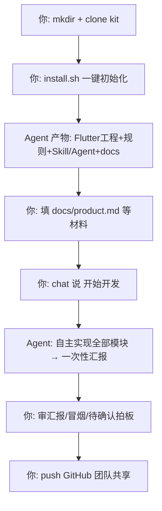
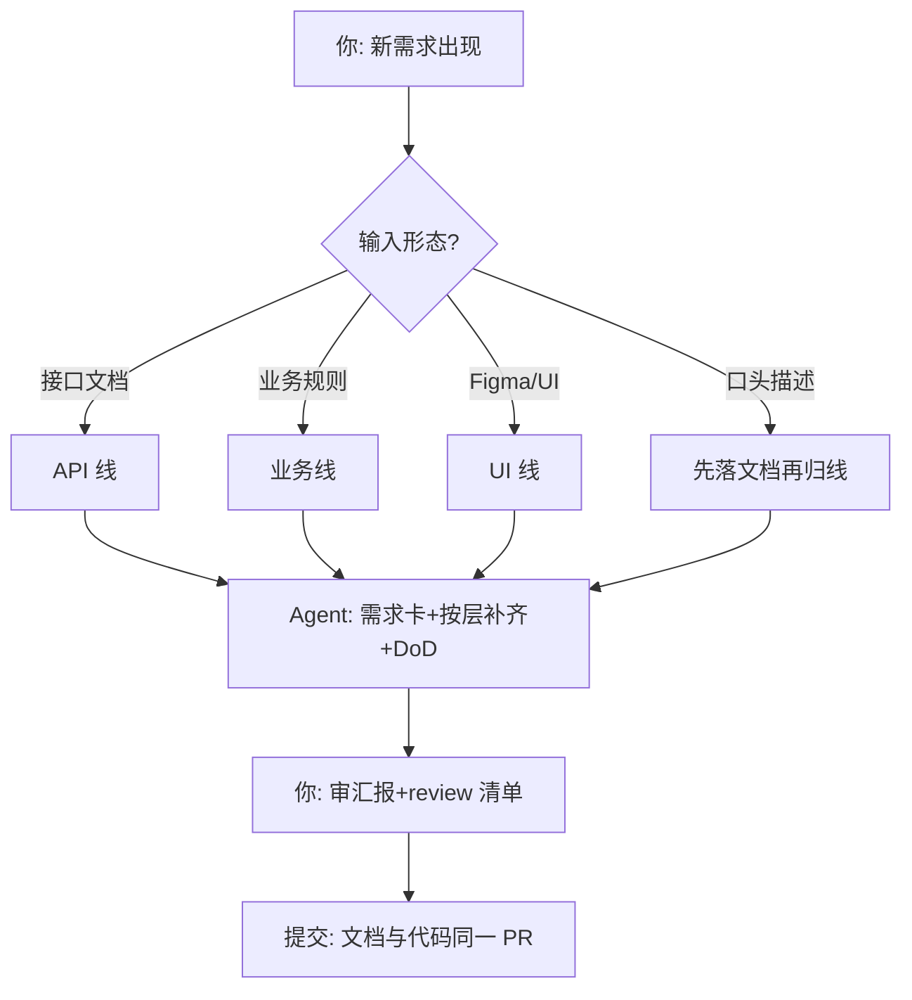

# AI Coding 完整流程总纲

> 本文是整个体系的**主流程地图**：两条主线——「新建项目」（从零到可开发）与「新增业务」（项目存续期的日常）。
> 每一步都标注了 **[你]**（用户操作）与 **[Agent]**（Copilot 自动执行），你只需要做带 [你] 的步骤。
> 细节按需深入：Playbook×5 与模板都在本 rules/ 目录。

---

## 主线 A · 新建项目（从零到可开发）



### A-1 准备（一次性，[你]）

| 依赖 | 说明 |
|---|---|
| Flutter SDK | `flutter doctor` 全绿 |
| VS Code + GitHub Copilot | Agent 模式可用 |
| flutter-dev-kit | `git clone https://github.com/chiguoqiang/flutter-dev-kit.git` |

### A-2 一键初始化（[你]，2 分钟）

```bash
mkdir myapp && cd myapp
git clone https://github.com/chiguoqiang/flutter-dev-kit.git
./flutter-dev-kit/install.sh "一句话：给谁用、解决什么"
```

### A-3 初始化产物（[Agent] 自动，你验收）

| 产物 | 位置 | 作用 |
|---|---|---|
| Flutter 工程 + 依赖 | `lib/ test/ pubspec.yaml` | 默认选型：Riverpod+dio+go_router+json_serializable+mocktail |
| 基础设施代码 | `ApiClient/主题/路由/首页` | 唯一 HTTP 出口、theme 取色、路由登记处 |
| 宪法 + 模块规则 | `AGENTS.md`×6 | 命令/红线/约定，Agent 自动遵守 |
| Skill+规则库+Agent | `.github/skills|agents/` | 随 Git 分发，同事 clone 零配置 |
| **产品文档区** | `docs/`（INTAKE + product 模板 + api/biz/ui/features） | **你唯一要碰的目录** |
| Git 基线 | 一笔干净首提交 | AI 改动可 diff 可回滚 |

kit 目录已自动删除，工程自包含。

### A-4 喂材料（[你]，材料的给法见 `INTAKE.md`）

| 材料 | 放哪/怎么给 | 可缺省？ |
|---|---|---|
| 产品规划 | 填 `docs/product.md` 模板 | ❌ 必需（缺则 Agent 出 MVP 草案找你确认一次） |
| 接口文档 | Apifox 分享 / OpenAPI / 后端仓库，直接发给 Agent | ✅ 缺则 mock 先行 |
| Figma | 贴链接（带 node-id 最佳），直接发给 Agent | ✅ 缺则 UI 基线生成 |

### A-5 发令（[你]，一句话）

> **「开始开发」**

### A-6 Agent 内部流水线（[Agent]，无需你操作）

```text
读 AGENTS.md(宪法) → 读 docs/INTAKE.md+product.md(要什么)
→ 拆模块清单+需求卡(docs/features/)
→ 逐模块循环（顺序固定，完成一个才进下一个）：
    接口 → PLAYBOOK-NEW-API   (model+service+test, mock 驱动)
    业务 → PLAYBOOK-BIZ-LOGIC (规则表/状态机 → 逐条测试)
    页面 → PLAYBOOK-UI-PAGE   (Figma/基线 → 四态+事件接线)
    每模块 DoD: analyze 零 error + test 全绿 + format + 红线自查
→ 一次性汇报
```

### A-7 验收（[你]，只看一页汇报）

1. **交付清单**：改了哪些文件（分 models/services/pages/widgets/test/docs）
2. **验证结果**：analyze/test 实际输出
3. **待确认决策** ★唯一必审：Agent 的所有假设与保守默认，逐条拍板
4. **遗留项**：真实联调、资源替换
5. `flutter run` 手动冒烟主流程；不满意直接在 chat 里继续提要求

### A-8 团队共享（[你]，可选）

```bash
git remote add origin <你的仓库地址> && git push -u origin main
# 同事 clone 即得完整体系（skill/agent/规则全随仓库），零配置
```

---

## 主线 B · 新增业务（项目存续期日常）



### B-1 判定输入形态（[你] 30 秒）

| 你手里有什么 | 走哪条线 | 依据文档 |
|---|---|---|
| 接口文档（Apifox/OpenAPI/后端仓库） | **接口线** | `flutter/PLAYBOOK-NEW-API.md` |
| 业务规则/计算公式/状态流转 | **业务线** | `flutter/PLAYBOOK-BIZ-LOGIC.md` |
| Figma 链接 / UI 稿 | **UI 线** | `flutter/PLAYBOOK-UI-PAGE.md` |
| 只有口头/文字想法 | 先让 Agent 落成 docs 文档再归线 | `flutter/BIZ-DOC-TEMPLATE.md` |

复合需求（如"新页面+新接口"）= 多线组合，Agent 会按 `model → service → state → UI → test` 统一排序。

### B-2 材料落位（[你] 给材料，[Agent] 整理入库）

- 接口/业务/Figma 材料直接在 chat 里发给 Agent
- Agent 整理为 `docs/api|biz|ui/` 标准文档，并在根 `AGENTS.md` 路由表登记
- 说不清的业务点 → Agent 列「待确认」，**不猜**

### B-3 发起（[你]，直接说人话即可）

> 「实现客户搜索模块，接口文档：<Apifox 链接>」
> 「加一个错题本：答错的题自动收录，可重做，答对移除」

也可先建需求卡（复制 `flutter/FEATURE-CARD.md` 到 `docs/features/`）再发给 Agent——大需求推荐。

### B-4 Agent 按层补齐（[Agent]，顺序固定不跳步）

```text
① model   不可变+序列化+可空性对齐文档      [L3: lib/models/AGENTS.md]
② service 唯一客户端+ApiException+脱敏日志 [L3: lib/services/AGENTS.md]
③ state   所选方案(Riverpod)+重建最小化     [L3: lib/AGENTS.md]
④ UI      页面+四态+事件表接线+theme取色    [L3: lib/pages/AGENTS.md]
⑤ test    成功+失败路径, 修bug先写复现用例  [L3: test/AGENTS.md]
⑥ 规则回写 新坑/新文档 → 更新最近的规则层与路由表
```

### B-5 验收与提交

- [你] 过对应线的 review 清单（接口线：字段可空性逐字段核对；UI 线：四态/还原度走查；业务线：规则表逐行有测试）
- [你] `flutter run` 冒烟新功能
- [Agent] DoD 全绿后提交：Conventional Commits，**文档与代码同一提交/PR**
- 后续迭代回到 B-1

---

## 两条主线的分工速记

| | 主线 A 新建项目 | 主线 B 新增业务 |
|---|---|---|
| 频率 | 每产品一次 | 日常反复 |
| 你要做的 | 3 行命令 + 填 product.md + 「开始开发」 | 给材料 + 一句话说需求 |
| Agent 做的 | 搭工程+落规则+实现全部模块 | 需求卡+按层补齐+测试+汇报 |
| 你的验收 | 一页汇报 + 待确认拍板 + 冒烟 | 对应线 review 清单 + 冒烟 |
| 产出物 | 完整可开发工程(Git 基线) | 垂直切片(model~test)+文档同步 |

**贯穿两条主线的铁律**：真实密钥永不入文档/代码（`--dart-define` 注入）；业务歧义 Agent 不猜、记「待确认」；每模块必过 DoD（analyze 零 error + test 全绿）；文档与代码同 PR 演进。
