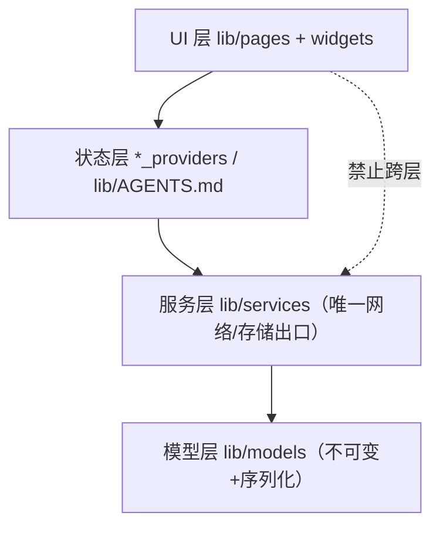
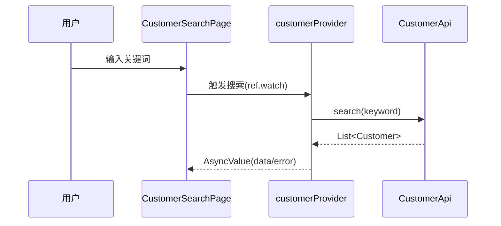

# 架构文档模板（ARCH-TEMPLATE）

> 用法：复制本模板到 `docs/architecture/architecture.md`。
> - **新项目**：开发前先填写（流程见 `PLAYBOOK-ARCHITECTURE.md` 通道 A）
> - **存量项目**：由 Agent 读代码反哺草稿，你确认后作为长期事实源（通道 B）
> 原则：**这张纸 = 项目架构的唯一事实源**，代码与它冲突即 bug（要么改码要么改文档+ADR）。

---

## 1. 定位与范围（3 行内）

<这个 App 是什么、核心用户、本文覆盖哪些端/模块；不覆盖什么>

## 2. 总体架构（分层图）

**架构模式：MVVM**（默认；如为其他模式须有 ADR）：View(pages/widgets) → ViewModel(*_providers) → Model(models+services)，数据流单向。

<按项目实际改写；非默认分层（如加入 domain/usecase、repository 拆分）必须附 ADR>

## 3. 分层职责与依赖规则（本项目的法律）

| 层 | 目录 | 职责 | 允许依赖 | 禁止 |
|---|---|---|---|---|
| UI | `lib/pages` `lib/widgets` | 布局/四态/事件接线 | 状态层、theme | import dio/http；写业务规则 |
| 状态 | `*_providers` 等 | 持状态、编排动作 | 服务层、模型层 | 存 BuildContext；网络直连 |
| 服务 | `lib/services` | 网络/存储/外部 SDK | 模型层、ApiClient | 把 Map 泄露给上层 |
| 模型 | `lib/models` | 数据+纯业务规则 | 无（纯 Dart） | import 任何 IO/框架 |

**依赖方向单向：UI → 状态 → 服务 → 模型。反向/跨层 import 视为架构违规。**

## 4. 模块划分（业务视角）

| 模块 | 核心文件 | 依赖的模块 | 说明 |
|---|---|---|---|
| <客户域> | customer_* | 无 | <边界一句话> |
| <任务域> | task_* | 客户域(只读) | <…> |

跨模块调用规则：<只经对方 service/provider 公开 API；禁止伸进对方私有文件>

## 5. 关键数据流（至少 1 条典型链路）

## 6. 横切约定（指向规则，不重复展开）

| 主题 | 约定所在 |
|---|---|
| 错误处理 | `lib/services/AGENTS.md`（ApiException 三分法） |
| 状态管理 | `lib/AGENTS.md`（或 docs/rules/state-management.md 覆盖版） |
| 路由 | `lib/router.dart` 唯一登记处 |
| 主题/样式 | `lib/theme/` |
| 日志 | 脱敏后经 <Logger>；禁止 print |

## 7. 架构决策记录（ADR 索引）

| ADR | 标题 | 状态 |
|---|---|---|
| [0001](adr/0001-xxx.md) | <例：引入 json_serializable 而非手写> | 已接受 |

**触发 ADR 的变更**：新增/删除分层、更换状态或网络方案、引入基础设施级三方库、
改变模块间依赖方向、新增平台通道/原生模块。——改架构先写 ADR 再动代码。

## 8. 已知技术债与演进方向

- <如：xxx 临时绕过，计划 v0.3 重构；诚实记录，review 时可见>
